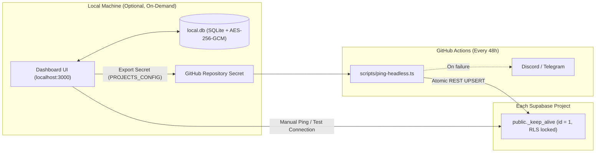

<div align="center">
  
  <h1>Supabase Keep-Alive</h1>
  <p>
    <strong>Keep Supabase free-tier databases active automatically without cloud hosting.</strong><br />
    Scheduled 48-hour GitHub Actions worker + optional local-first SQLite monitoring dashboard.
  </p>
  <p>
    <a href="#how-it-works">How It Works</a> &middot;
    <a href="#step-1-prepare-each-supabase-project">SQL Setup</a> &middot;
    <a href="#mode-1-github-actions-recommended-for-247-automation">GitHub Actions</a> &middot;
    <a href="#mode-2-local-dashboard-localhost3000">Local Dashboard</a> &middot;
    <a href="#mode-3-docker-compose">Docker</a> &middot;
    <a href="#failure-alerts-discord-and-telegram">Alerts</a> &middot;
    <a href="#faq">FAQ</a>
  </p>
</div>

---

## Why This Exists

Supabase pauses free-tier projects after **7 days of database inactivity**. Running a separate cloud server or cron service just to ping your projects defeats the purpose of staying on a zero-cost stack.

**Supabase Keep-Alive** solves this with two decoupled parts in a single repository:

1. **Automated Cloud Worker (GitHub Actions):** Runs every **48 hours** (`0 0 */2 * *`) on GitHub's runners using a single encrypted `PROJECTS_CONFIG` repository secret. Your computer does **not** need to stay on.
2. **Local-First Dashboard (`localhost:3000`):** An optional Next.js + SQLite UI you open whenever you want to add projects, verify live connectivity, inspect latency history, and export the `PROJECTS_CONFIG` JSON secret with one click.

---

## How It Works



> [!NOTE]
> The Local Dashboard and GitHub Actions run independently and never conflict. Both perform an atomic REST `UPSERT` on row `id = 1` of `public._keep_alive`. You can close the local dashboard anytime — GitHub Actions keeps running on schedule in the cloud.

---

## Step 1: Prepare Each Supabase Project

Before adding a project, run the SQL below once inside your Supabase project's **SQL Editor**.

**What this script does:**
- Creates an isolated table `public._keep_alive` restricted by `CHECK (id = 1)` so only a single row can ever exist.
- Seeds row `id = 1` safely (`ON CONFLICT DO NOTHING`).
- Enables Row Level Security (`RLS`) with `SELECT`, `INSERT`, and `UPDATE` policies scoped strictly to `anon` and `id = 1`.
- Never reads, alters, or deletes any of your existing application tables or user data.

```sql
CREATE TABLE IF NOT EXISTS public._keep_alive (
  id integer PRIMARY KEY CHECK (id = 1),
  last_ping timestamptz NOT NULL DEFAULT now()
);

INSERT INTO public._keep_alive (id, last_ping)
VALUES (1, now())
ON CONFLICT (id) DO NOTHING;

ALTER TABLE public._keep_alive ENABLE ROW LEVEL SECURITY;

DO $$
BEGIN
  IF NOT EXISTS (
    SELECT 1 FROM pg_policies
    WHERE schemaname = 'public'
      AND tablename = '_keep_alive'
      AND policyname = 'allow_anon_keep_alive_select'
  ) THEN
    CREATE POLICY "allow_anon_keep_alive_select"
      ON public._keep_alive
      FOR SELECT
      TO anon
      USING (id = 1);
  END IF;

  IF NOT EXISTS (
    SELECT 1 FROM pg_policies
    WHERE schemaname = 'public'
      AND tablename = '_keep_alive'
      AND policyname = 'allow_anon_keep_alive_insert'
  ) THEN
    CREATE POLICY "allow_anon_keep_alive_insert"
      ON public._keep_alive
      FOR INSERT
      TO anon
      WITH CHECK (id = 1);
  END IF;

  IF NOT EXISTS (
    SELECT 1 FROM pg_policies
    WHERE schemaname = 'public'
      AND tablename = '_keep_alive'
      AND policyname = 'allow_anon_keep_alive_update'
  ) THEN
    CREATE POLICY "allow_anon_keep_alive_update"
      ON public._keep_alive
      FOR UPDATE
      TO anon
      USING (id = 1)
      WITH CHECK (id = 1);
  END IF;
END $$;

GRANT USAGE ON SCHEMA public TO anon;
GRANT SELECT, INSERT, UPDATE ON TABLE public._keep_alive TO anon;
```

> [!TIP]
> If Supabase displays a **"Potential issue detected"** confirmation because of `ALTER TABLE ... ENABLE ROW LEVEL SECURITY`, click **Run query** — enabling RLS on this newly created `_keep_alive` table is intentional and safe.

---

## Mode 1: GitHub Actions (Recommended for 24/7 Automation)

Use this mode to keep your Supabase projects active every 48 hours without keeping your computer running.

1. **Fork or clone** this repository to your GitHub account.
2. Open your repository on GitHub and go to **Settings** (repository tab) -> **Secrets and variables** -> **Actions**.
3. Under **Repository secrets**, click **New repository secret**:
   - **Name:** `PROJECTS_CONFIG`
   - **Secret:** paste the JSON array of your Supabase projects (you can generate this automatically using **Export Secret** in the Local Dashboard, or write it manually):

```json
[
  {
    "name": "production-core",
    "url": "https://your-project-ref.supabase.co",
    "anonKey": "eyJhbGciOiJIUzI1NiIsInR5cCI6IkpXVCJ9..."
  },
  {
    "name": "staging-app",
    "url": "https://your-staging-ref.supabase.co",
    "anonKey": "eyJhbGciOiJIUzI1NiIsInR5cCI6IkpXVCJ9..."
  }
]
```

4. *(Optional)* Add failure notification secrets as **separate Repository Secrets** (do **not** put them inside the `PROJECTS_CONFIG` JSON). See [Failure Alerts (Discord and Telegram)](#failure-alerts-discord-and-telegram) for setup details:
   - `DISCORD_WEBHOOK_URL`
   - `TELEGRAM_BOT_TOKEN`
   - `TELEGRAM_CHAT_ID`
5. Go to **Actions -> Supabase Keep-Alive -> Run workflow** to trigger an immediate test run. Going forward, GitHub runs it automatically every 48 hours (`0 0 */2 * *`).

> [!IMPORTANT]
> GitHub Actions `schedule` triggers only run on your repository's **default branch** (`master` or `main`). Use **Run workflow** (`workflow_dispatch`) when testing manually on another branch.

You can also run the headless script directly from your terminal:

```bash
PROJECTS_CONFIG='[{"name":"demo","url":"https://your-ref.supabase.co","anonKey":"your-anon-key"}]' npx tsx scripts/ping-headless.ts
```

---

## Mode 2: Local Dashboard (`localhost:3000`)

Use the local dashboard to manage targets visually, run live connection tests before saving, inspect ping latency logs, and export your `PROJECTS_CONFIG` JSON.

### Prerequisites

- Node.js 20+ (tested on Node 22 and Node 26)

### Quick Start

```bash
npm install
cp .env.example .env.local
npm run dev
```

Open `http://localhost:3000` in your browser.

### What Happens Automatically

- **Zero-Config SQLite (`local.db`):** Tables `projects` and `ping_logs` are created on first boot with no manual migrations.
- **AES-256-GCM Encryption:** Every `anonKey` is encrypted with a random 12-byte IV and GCM auth tag before being written to SQLite, and decrypted only in server memory when pinging or exporting secrets. If `ENCRYPTION_KEY` is omitted, a 32-byte key is generated in `.env.local` on first run.
- **Live Connection Tester:** Verify your Supabase URL, `anonKey`, and `public._keep_alive` RLS policies inside **Add Project** before saving.
- **Secret Bridge:** Click **Export Secret** to copy a clean JSON array ready for GitHub's `PROJECTS_CONFIG` secret.

---

## Mode 3: Docker Compose

Run the local dashboard inside a container with persistent SQLite storage:

```bash
ENCRYPTION_KEY=$(node -e "console.log(require('crypto').randomBytes(32).toString('hex'))") docker compose up --build -d
```

Open `http://localhost:3000`. Database state is stored in the `keep_alive_data` Docker volume.

---

## Failure Alerts (Discord and Telegram)

You can configure **Discord**, **Telegram**, or **both simultaneously**. Whenever a ping fails (`HTTP` error or network timeout), `core/notifier.ts` sends a plain-text summary of the failed project(s). Successful pings (`HTTP 200`) do not send messages so your channels stay quiet.

### 1. Obtain Your Credentials

- **Discord (`DISCORD_WEBHOOK_URL`):**
  1. Open your Discord server -> **Server Settings -> Integrations -> Webhooks**.
  2. Click **New Webhook**, select the target channel, and click **Copy Webhook URL**.
- **Telegram (`TELEGRAM_BOT_TOKEN` and `TELEGRAM_CHAT_ID`):**
  1. Message `@BotFather` on Telegram and run `/newbot` to receive your `TELEGRAM_BOT_TOKEN`.
  2. Send `/start` (or any message) to your new bot.
  3. Find your `TELEGRAM_CHAT_ID` via `@userinfobot` or by visiting `https://api.telegram.org/bot<YOUR_TOKEN>/getUpdates`.

### 2. Where to Put Them

> [!IMPORTANT]
> Do **not** place Discord or Telegram keys inside the `PROJECTS_CONFIG` JSON array. They are always configured as separate environment variables / repository secrets.

- **For GitHub Actions:**
  Open your repository -> **Settings -> Secrets and variables -> Actions -> Secrets**, and click **New repository secret** for each key alongside `PROJECTS_CONFIG`:
  - `DISCORD_WEBHOOK_URL` = `https://discord.com/api/webhooks/...`
  - `TELEGRAM_BOT_TOKEN` = `123456789:AAH...`
  - `TELEGRAM_CHAT_ID` = `987654321` (or `-100...` for a group/channel)
- **For Local Dashboard & Docker:**
  Add the same keys to `.env.local` (see `.env.example`), then restart `npm run dev` or `docker compose up -d`:

```env
DISCORD_WEBHOOK_URL=https://discord.com/api/webhooks/...
TELEGRAM_BOT_TOKEN=123456789:AAH...
TELEGRAM_CHAT_ID=987654321
```

### 3. Test Alerts Locally

Run the headless script with an intentionally invalid Supabase URL to trigger a failure alert without touching your real projects:

```bash
DISCORD_WEBHOOK_URL="https://discord.com/api/webhooks/..." \
TELEGRAM_BOT_TOKEN="123456789:AAH..." \
TELEGRAM_CHAT_ID="987654321" \
PROJECTS_CONFIG='[{"name":"alert-test","url":"https://invalid-test-ref.supabase.co","anonKey":"invalid-key-1234567890"}]' \
npx tsx scripts/ping-headless.ts
```

A successful delivery logs `[keep-alive] Failure alerts delivered via: discord, telegram`.

---

## Project Structure

```text
supabase-keep-alive/
├── .github/workflows/keep-alive.yml   # 48h scheduled workflow + workflow_dispatch
├── app/
│   ├── icon.svg                       # Monochrome heartbeat favicon
│   ├── globals.css                    # Light/dark monochrome tokens & responsive table styles
│   ├── layout.tsx                     # Root layout (Inter & JetBrains Mono)
│   ├── page.tsx                       # Local monitoring dashboard
│   └── api/                           # SQLite CRUD, ping, test, and secret export endpoints
├── components/
│   ├── ui/                            # Reusable primitives (Button, Badge, Modal, CopyButton, Logo)
│   └── dashboard/                     # ProjectTable, ProjectRow, and setup/export modals
├── core/
│   ├── pinger.ts                      # Shared Supabase REST UPSERT and latency timer
│   ├── notifier.ts                    # Optional Discord and Telegram failure webhooks
│   └── types.ts                       # Shared domain TypeScript interfaces
├── lib/
│   ├── crypto.ts                      # AES-256-GCM encrypt/decrypt utilities
│   ├── db.ts                          # Auto-initializing SQLite database (Drizzle ORM)
│   └── utils.ts                       # Validation, formatting, and public._keep_alive SQL
├── scripts/
│   └── ping-headless.ts               # CLI entry point for GitHub Actions
├── Dockerfile                         # Container build definition
├── docker-compose.yml                 # Local Docker Compose setup
└── .env.example                       # Environment variable template
```

---

## Environment Variables

| Variable | Where Used | Required | Description |
| --- | --- | --- | --- |
| `ENCRYPTION_KEY` | Local / Docker | Recommended | 64-character hex key (32 bytes) for AES-256-GCM encryption of `anonKey` in SQLite. |
| `DATABASE_PATH` | Local / Docker | Optional | Path to the SQLite database file (defaults to `./local.db`). |
| `DISCORD_WEBHOOK_URL` | Both | Optional | Discord webhook URL notified when any ping fails. |
| `TELEGRAM_BOT_TOKEN` | Both | Optional | Telegram bot token paired with `TELEGRAM_CHAT_ID` for failure alerts. |
| `TELEGRAM_CHAT_ID` | Both | Optional | Target Telegram chat ID for failure alerts. |
| `PROJECTS_CONFIG` | GitHub Actions | Required in CI | JSON array of `{ name, url, anonKey }` targets read by `scripts/ping-headless.ts`. |

---

## FAQ

**Does my computer need to stay on for keep-alive pings to work?**
No. Once `PROJECTS_CONFIG` is saved in GitHub Repository Secrets, GitHub Actions runs on GitHub's servers every 48 hours even when your computer is turned off.

**Why doesn't the local dashboard automatically show runs triggered by GitHub Actions?**
By design, there is no cloud backend syncing them. Your local dashboard reads only from `local.db` on your machine, and updates when you click **Ping** or **Ping All**. To verify automated cloud runs, check the **Actions** tab on GitHub or inspect the `last_ping` timestamp in `public._keep_alive` on Supabase.

**Will running the local dashboard and GitHub Actions at the same time cause a conflict?**
No. Both send an atomic PostgreSQL `UPSERT` (`ON CONFLICT (id) DO UPDATE`) targeting `id = 1`, which PostgreSQL serializes safely without errors or duplicate rows.

**Where is the repository secrets page on GitHub?**
Open your repository (not your personal profile settings), go to **Settings -> Secrets and variables -> Actions -> Secrets -> New repository secret**.

---

## Verification

```bash
npm run lint
npx tsc --noEmit
npm run build
```
